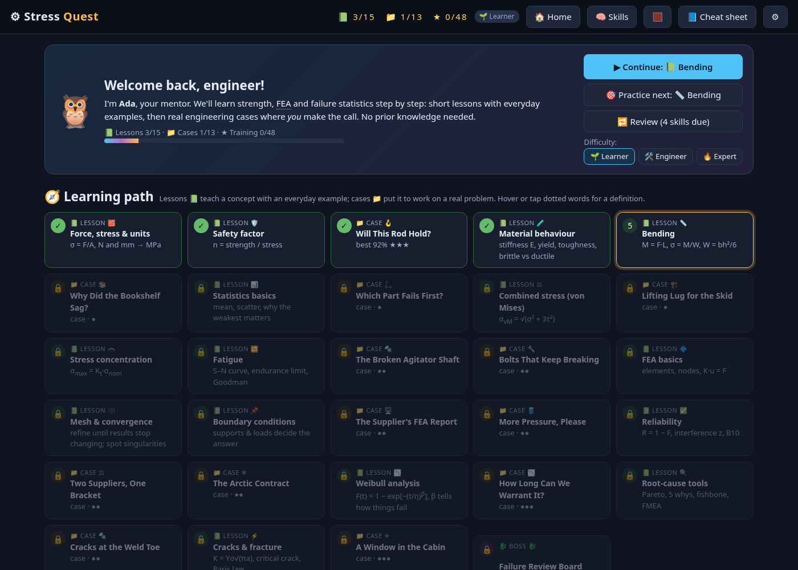
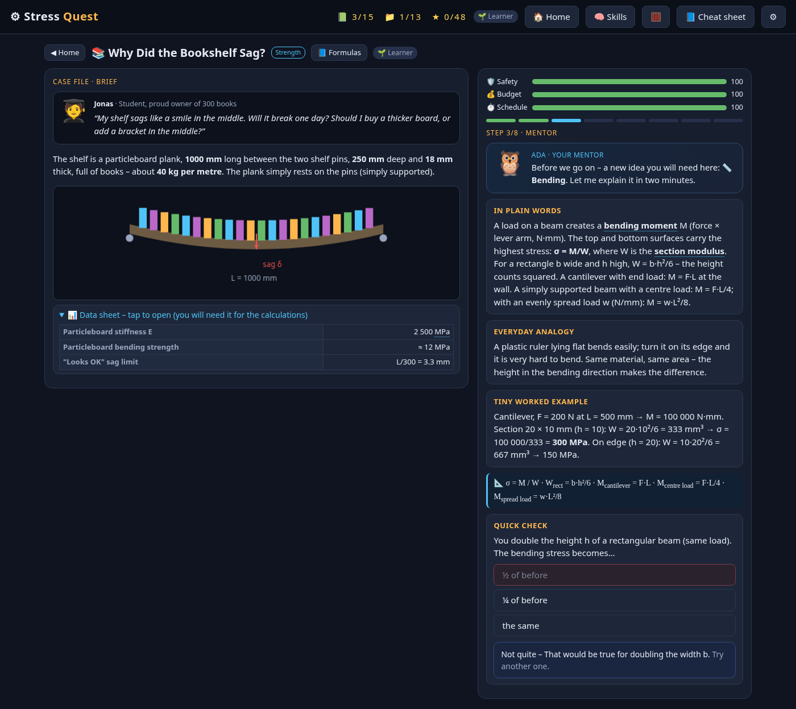
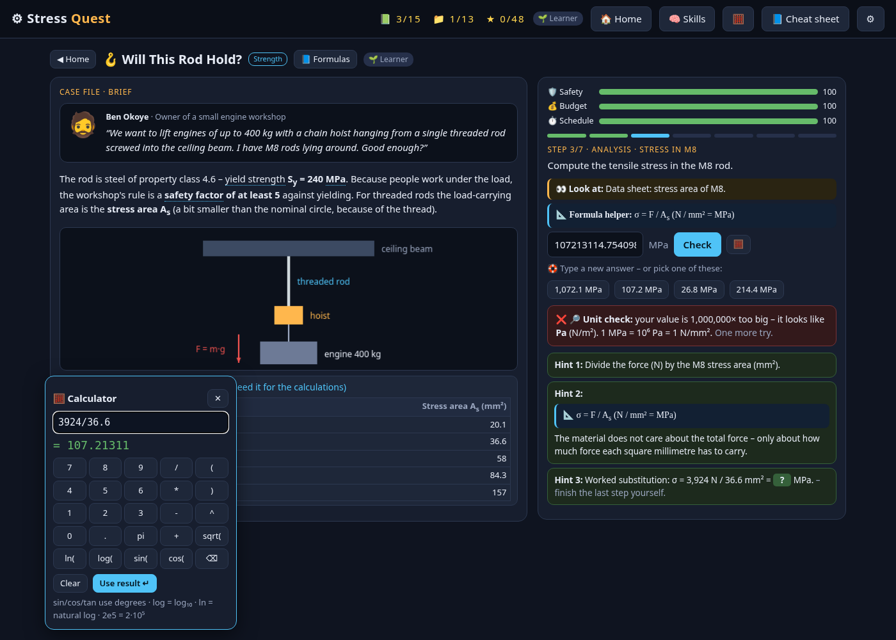
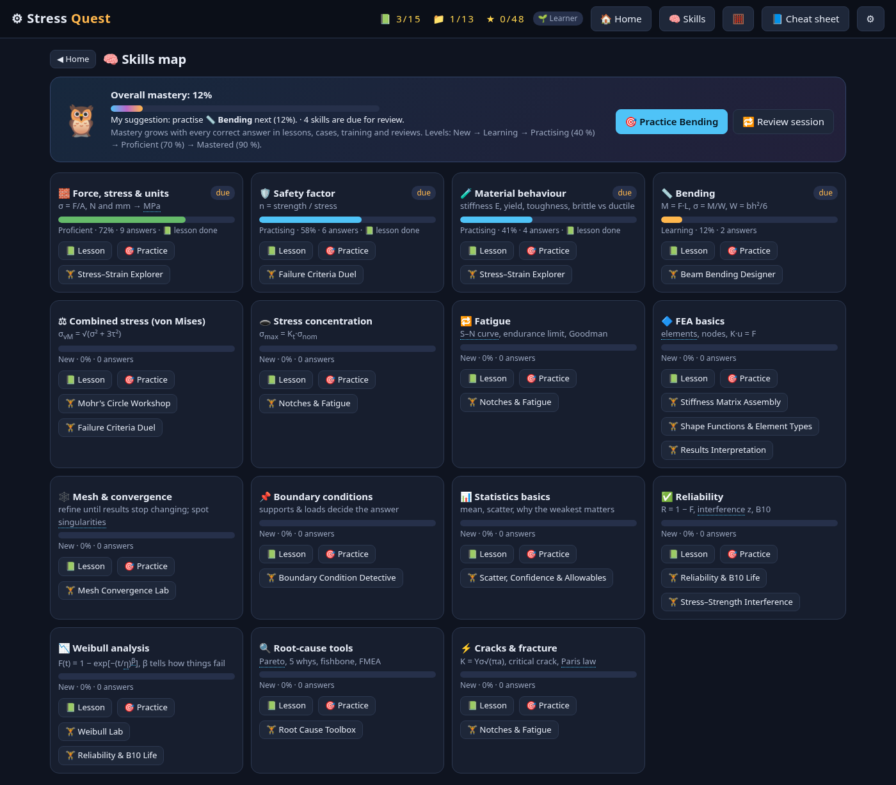
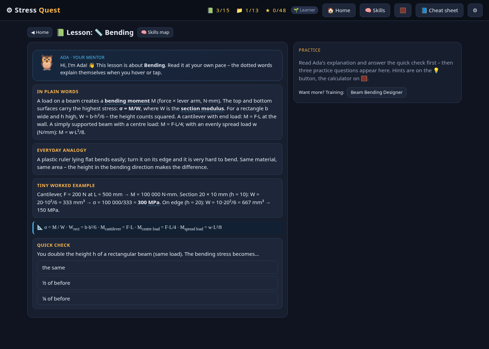
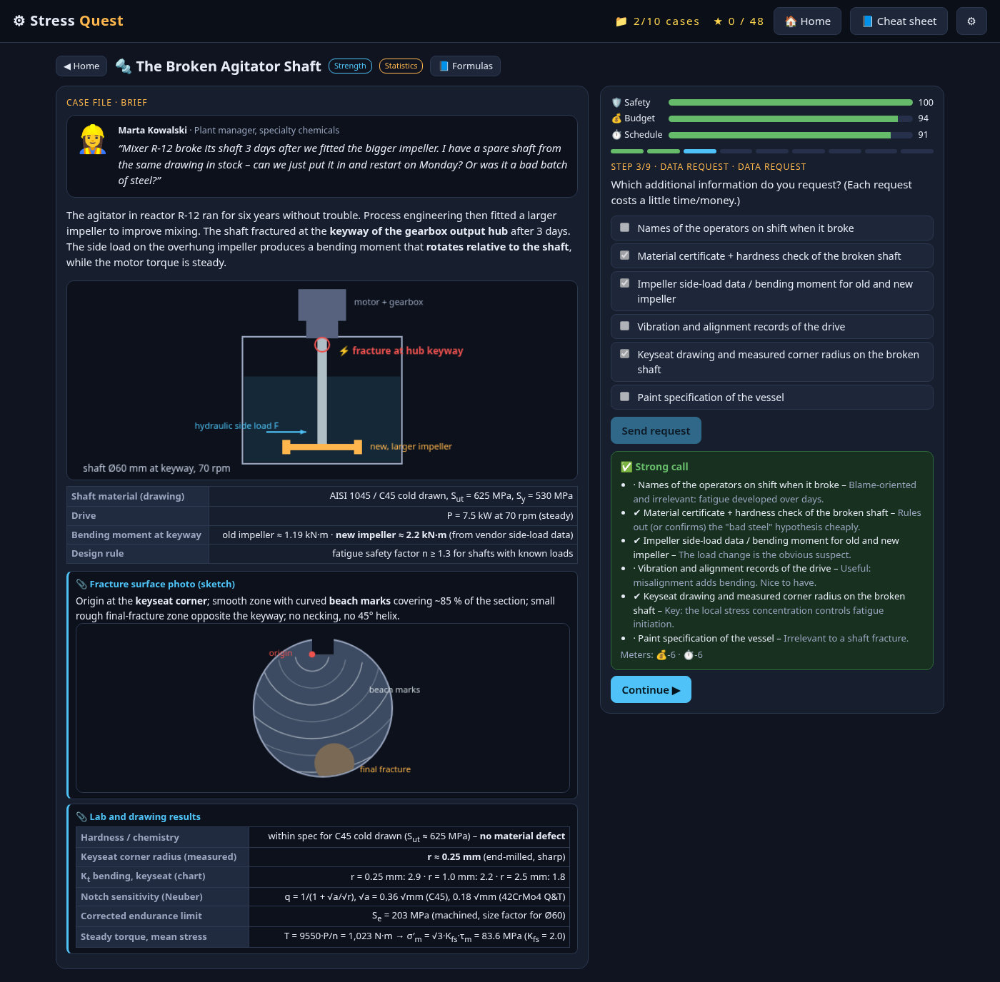
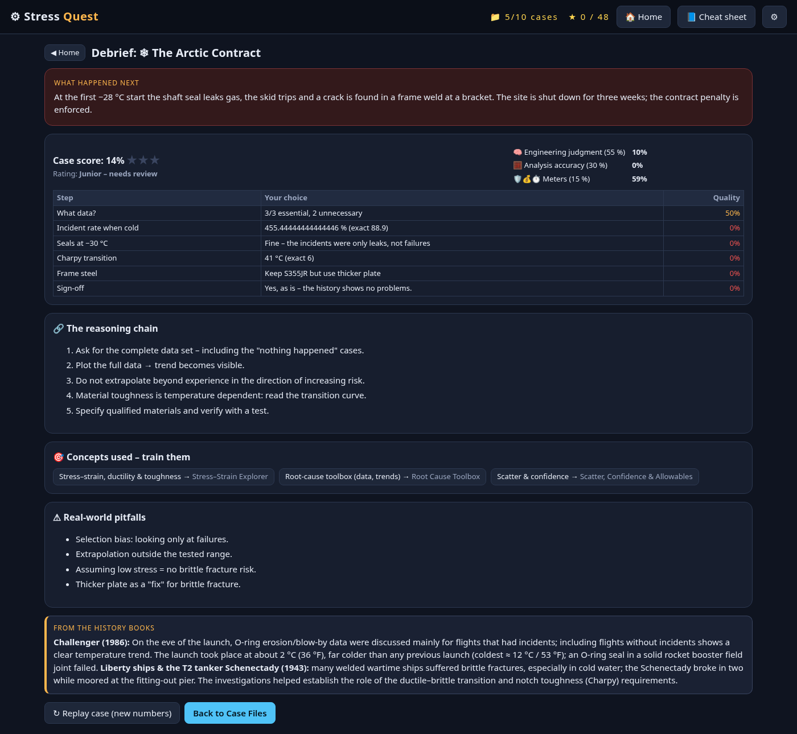

# Stress Quest ⚙️

A browser game for learning **mechanical strength theory**, the **finite element method (FEA)** and **statistical tools for failure analysis**, and for applying them to real engineering problems.

**Play:** https://hoanghaiphan.github.io/stress-quest/ (or download `index.html` and open it in any browser; it works offline).

## 🌱 Made for learners
No prior knowledge is needed. The game is built for someone who wants to *master* the concepts, not for experts.

- **Learning path:** home shows one path from fundamentals to advanced. It interleaves short **lessons** 📗 with **cases** 📁. Each case unlocks once you have done the lessons it needs and the case before it. "Unlock all" in ⚙ Settings opens everything.
- **Teach before test:** Ada 🦉, your mentor, introduces every concept the first time you meet it: plain words, an everyday analogy, a tiny worked example, the formula and a quick check. Dotted words are glossary terms; hover over them or tap them for a definition.
- **Hint ladder on every question** (lessons, cases, Training and the boss): 💡 nudge → formula plus why it applies → worked substitution with *your* numbers. A 🧮 calculator (with "use result") and a formula helper sit next to each calculation. Tolerance is ±5 %. A specific **unit check** message appears for typical slips: Pa vs MPa, m vs mm, mm² vs m², kN vs N, kg vs N, N·m vs N·mm, % vs fraction, r vs d.
- **Difficulty modes:**
  - **🌱 Learner** (default): free hints, the mentor, a multiple-choice rescue after a miss, rounded numbers in cases, the data sheet collapsed and "👀 look at" focus hints, an explanation of every option after a decision, and advanced sub-steps worked through by the mentor.
  - **🛠 Engineer:** the original challenge, with a small hint cost.
  - **🔥 Expert:** one try, no hints, a longer boss.
- **Skills map** (🧠): 15 skills with mastery levels (New → Learning → Practising → Proficient → Mastered), "practice this next", and a **spaced-repetition review** (Leitner boxes) of skills that are due. Progress is celebrated with skill-up toasts.
- **Optional, adaptive boss:** the Failure Review Board unlocks after 6 lessons, 4 cases or 8 starred levels. It has 6 / 10 / 12 questions by mode; in Learner it favours skills you have practised.

**Lessons (15):** Force, stress & units · Safety factor · Material behaviour · Bending · Statistics basics · Combined stress (von Mises) · Stress concentration · Fatigue · FEA basics · Mesh & convergence · Boundary conditions · Reliability · Weibull analysis · Root-cause tools · Cracks & fracture.

**New intro cases:**
- **i1 Will This Rod Hold?:** F = m·g, σ = F/A_s, safety factor and picking a threaded rod size.
- **i2 Why Did the Bookshelf Sag?:** uniform load, M = wL²/8, σ = M/W, sag 5wL⁴/384EI and which fix works best.
- **i3 Which Part Fails First?:** why the average hides the early failures; compare two hinge suppliers.

 

 

## 📁 Case Files (problem-based learning)
The headline mode. Each case is a realistic engineering problem, and you are the engineer. A stakeholder (plant manager, purchasing, sales, a supplier) brings a question with a brief: the situation, a sketch, data tables. You work through the investigation step by step:

- **Data requests:** choose which information to ask for. Each request costs time and money, and missing the key evidence costs you points.
- **Decisions:** pick the analysis, model or tool. Plausible wrong options are included, such as thin-wall theory for a thick cylinder, the mean instead of a tolerance bound, or trusting an FE singularity.
- **Analysis:** compute with real (randomized) numbers. Answers are checked with engineering tolerances.
- **Recommendation:** your final call has consequences ("what happened next", e.g. field returns six months later).

Decisions move the 🛡 safety, 💰 budget and ⏱ schedule meters. The case score is 55 % engineering judgment, 30 % analysis accuracy and 15 % meters. After each case a **debrief** shows the reasoning chain, the concepts used (with buttons that open the matching Training level), real-world pitfalls and, where applicable, the real incident that inspired the case.

| # | Case | Domains | Concepts |
|---|------|---------|----------|
| 1 | The Broken Agitator Shaft | Strength, Statistics | fractography, M/W bending, Kt→Kf (Neuber), Marin endurance limit, Goodman, Basquin life, redesign trade-off (Eschede 1998) |
| 2 | Lifting Lug for the Skid | Strength | sling-angle forces, dynamic factor, strong/weak-axis bending, von Mises, design factor on yield, net section (Silver Bridge 1967) |
| 3 | The Supplier's FEA Report | FEA, Strength | singularity vs convergence, mesh-study ratio, defeaturing, hand check σ = M/W, safety factor (Sleipner A 1991) |
| 4 | More Pressure, Please | Strength | thin-wall vs Lamé, von Mises at the bore, weld efficiency, proof test, burst pressure (Grover Shoe Factory 1905 / ASME code) |
| 5 | Bolts That Keep Breaking | Strength, Statistics | torque–preload, joint constant, separation load, bolt stress amplitude, bolt Goodman, Junker loosening |
| 6 | How Long Can We Warrant It? | Statistics | suspensions/censoring, adjusted ranks, Weibull plot, β interpretation, B10, warranty claim fraction |
| 7 | Two Suppliers, One Bracket | Statistics, Strength | B-basis allowables, stress–strength interference, ppm failure rate, cost of failure (MIL-HDBK-5/MMPDS) |
| 8 | The Arctic Contract | Statistics, Strength | selection bias in failure data, extrapolation, Charpy ductile–brittle transition, steel grade selection (Challenger 1986, Liberty ships) |
| 9 | A Window in the Cabin | Strength, FEA | hoop stress pR/t, Kt at cutout corners, S–N life, critical crack length, Paris-law growth, inspection interval (Comet 1954, Aloha 243 1988) |
| 10 | Cracks at the Weld Toe | Statistics, Strength | Pareto, root cause, IIW FAT classes, weld toe grinding, FMEA priority, design-change control (Hyatt Regency 1981) |

Numbers are randomized on every replay, so each case can be replayed. Case progress is saved in local storage under the same key as before, so older saves keep working.

 

## 🎯 Training grounds
The original drill levels are now the **Training** section below the Case Files. Cases link back to them.

## Worlds and levels
**World 1: Strength theory.** Stress–strain explorer, Mohr's circle, failure criteria (von Mises, Tresca, Rankine, Coulomb–Mohr), beam bending designer, notches and fatigue (Kt, Goodman/Gerber/Soderberg, S–N).

**World 2: FEA.** Stiffness matrix assembly, mesh convergence and singularities, shape functions and shear locking, boundary condition detective, results interpretation.

**World 3: Failure statistics.** Weibull lab, reliability and B10 life, stress–strength interference, scatter, confidence and B-basis allowables, root-cause tools (Pareto, fishbone, FMEA RPN).

**Final boss (optional):** the Failure Review Board, with mixed questions (6, 10 or 12 depending on the mode).

Each level starts with a concept card and key formulas. Answers are checked with engineering tolerances and explained, parameters are randomized on every replay, and progress is saved in the browser's local storage.

## Simplifications
- In Learner mode, case numbers are rounded to 2–3 significant figures, and a few advanced sub-steps (e.g. notch factor, crack growth) are shown worked out instead of being scored.
- Case Files use simplified, textbook-level models (e.g. Kt charts as given values, Paris law with a constant geometry factor, IIW FAT classes given for the detail). They teach the reasoning, not code compliance.
- Incident references are short, conservative summaries; see the official investigation reports for details.
- Mesh convergence uses a modelled convergence behaviour, not a live FE solver.
- The stress–strain curve is a synthetic piecewise model.
- Fatigue assumes Kf = Kt.
- The Weibull fit uses rank regression, not maximum likelihood.
- Confidence and B-basis factors assume n = 10.

## Repo layout
- `index.html` is the complete, self-contained game.
- `src/` holds the parts it is built from: `cat src/* > index.html`.
- `tests/` holds the headless-browser test scripts (Playwright): `run.py` auto-plays all Training levels; `cases.py` auto-plays every case on the best path, the worst path and mixed/random paths, and checks that a debrief appears with zero console errors; `case_shots.py` takes the screenshots. `learn.py` plays the novice path (every lesson and case, using hints, wrong answers and the MC rescue) in Learner, Engineer and Expert, checks the unit-mistake detection, gating, review, the boss and tooltips. `learn_shots.py` takes the learner screenshots. `run.py` honours `SQ_MODE=learner|engineer`.
