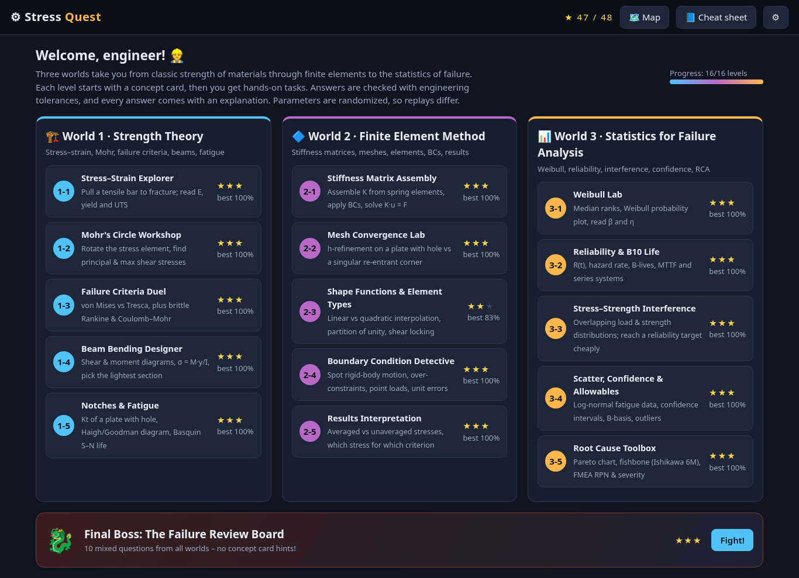

# Stress Quest ⚙️

A browser game for learning **mechanical strength theory**, the **finite element method (FEA)** and **statistical tools for failure analysis**.

**Play:** https://hoanghaiphan.github.io/stress-quest/ (or download `index.html` and open it in any browser; it works offline).

## Worlds and levels
**World 1: Strength theory.** Stress–strain explorer, Mohr's circle, failure criteria (von Mises, Tresca, Rankine, Coulomb–Mohr), beam bending designer, notches and fatigue (Kt, Goodman/Gerber/Soderberg, S–N).

**World 2: FEA.** Stiffness matrix assembly, mesh convergence and singularities, shape functions and shear locking, boundary condition detective, results interpretation.

**World 3: Failure statistics.** Weibull lab, reliability and B10 life, stress–strength interference, scatter, confidence and B-basis allowables, root-cause tools (Pareto, fishbone, FMEA RPN).

**Final boss:** the Failure Review Board, with 10 mixed questions.

Each level starts with a concept card and key formulas. Answers are checked with engineering tolerances and explained, parameters are randomized on every replay, and progress is saved in the browser's local storage.

## Simplifications
- Mesh convergence uses a modelled convergence behaviour, not a live FE solver.
- The stress–strain curve is a synthetic piecewise model.
- Fatigue assumes Kf = Kt.
- The Weibull fit uses rank regression, not maximum likelihood.
- Confidence and B-basis factors assume n = 10.

## Repo layout
- `index.html` is the complete, self-contained game.
- `src/` holds the parts it is built from: `cat src/* > index.html`.
- `tests/` holds the headless-browser test scripts (Playwright).
